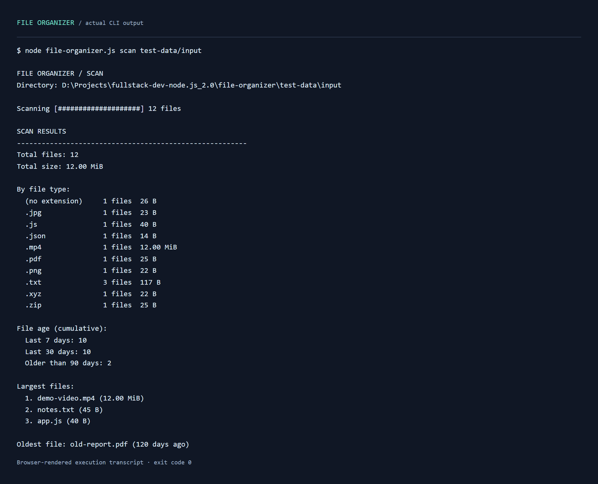

# File Organizer

**Understand your files. Find repeated content. Turn a cluttered folder into a clear library.**

A dependency-free Node.js command-line application for inspecting and organizing any directory. Scan nested folders, find identical files by content, copy files into useful categories, and preview old files before removing them.



## Features

- **A useful inventory:** total size, extension breakdown, modification ages, three largest files and the oldest file.
- **Content-based duplicate detection:** streamed SHA-256 hashes identify identical content even when filenames differ; reports include full paths and redundant storage.
- **Non-destructive organization:** copies into six categories while preserving source files and numbering filename collisions.
- **Preview-first cleanup:** lists candidates by modification age; deletion requires an explicit `--confirm`.
- **Streaming large files:** copies files of 10 MiB or more with a stream pipeline; hashes all files through streams.
- **Reusable event-driven modules:** each command extends `EventEmitter`, independently of console rendering.

## Get started

Requires **Node.js 22 or newer** and npm. No application dependencies or installation step are needed.

```sh
git clone https://github.com/vikkrat/woolf-node-file-organizer.git
cd woolf-node-file-organizer
node file-organizer.js --help
```

The commands accept any directory you provide. There is no automatic Downloads path. Quote paths containing spaces.

### Try it with disposable demo files

```sh
npm run demo:setup
npm run scan -- test-data/input
npm run duplicates -- test-data/input
npm run organize -- test-data/input --output test-data/organized
npm run cleanup -- test-data/input --older-than 90
```

The setup script creates `test-data/input` inside the project, with 12 files: nested folders, matching content, conflicting names, uppercase and unknown extensions, two files aged 120 days, and a 12 MiB placeholder video. Media/document fixtures are placeholders, not valid playable media. Setup refuses to overwrite an existing input directory. Test data and organized output are ignored by Git.

## Commands

### Scan

```sh
node file-organizer.js scan "path/to/folder"
npm run scan -- test-data/input
```

Recursively reports file count, total bytes, extension statistics, modification age, largest files and the oldest file. “Last 7 days” and “Last 30 days” are cumulative counts: a recent file belongs to both. Sizes use binary units (KiB, MiB, GiB). Empty folders are supported.

### Find duplicates

```sh
node file-organizer.js duplicates "path/to/folder"
npm run duplicates -- test-data/input
```

Computes SHA-256 incrementally and prints groups with matching content, full file paths and hashes. Wasted space is `file size × (number of copies − 1)`. This command only reports duplicates; it does not delete them. Zero-byte duplicates are supported.

### Organize

```sh
node file-organizer.js organize "path/to/source" --output "path/to/sorted"
npm run organize -- test-data/input --output test-data/organized
```

`--output` is required. Source and destination must be separate directories: neither may contain the other. The destination is created automatically. Nested source files are flattened into categories. Original files remain in place.

| Category | Recognized extensions |
| --- | --- |
| Documents | pdf, docx, doc, txt, md, xlsx, pptx, csv |
| Images | png, jpg, jpeg, gif, svg, webp, bmp |
| Archives | zip, rar, tar, gz, 7z |
| Code | js, mjs, ts, py, java, cpp, html, css, json |
| Videos | mp4, avi, mkv, mov, webm |
| Other | Unrecognized extensions and extensionless files |

Extension matching ignores case. Existing names receive suffixes: `notes.txt`, `notes(1).txt`, `notes(2).txt`. Repeated runs create additional copies; organization is not a synchronization operation. Small files use exclusive `copyFile`; files at least 10 MiB use `pipeline` with an exclusively created destination.

### Cleanup

```sh
# Preview only: nothing is deleted.
node file-organizer.js cleanup test-data/input --older-than 90

# Delete the listed old demo files.
node file-organizer.js cleanup test-data/input --older-than 90 --confirm
```

`--older-than` is required and accepts a finite, non-negative number of days, including fractions. Age is based on the last modification time, not creation time. The comparison is strictly older than the threshold. Without `--confirm`, the command always runs as a preview. With it, the application prints the list and deletes immediately without an interactive prompt. Deletion is permanent; directories are retained.

## Execution gallery

These images are **browser-rendered transcripts of real CLI runs**, not native terminal screenshots. The capture tool preserves actual stdout without rewriting results. Each image has a companion text log. All demonstration operations used only the generated project-local fixtures.

| Run | Image | Raw log |
| --- | --- | --- |
| Recursive inventory | [Scan](screenshots/01-scan.png) | [Text](screenshots/01-scan.txt) |
| Matching content | [Duplicates](screenshots/02-duplicates.png) | [Text](screenshots/02-duplicates.txt) |
| Category copies | [Organize](screenshots/03-organize.png) | [Text](screenshots/03-organize.txt) |
| Cleanup preview | [Dry run](screenshots/04-cleanup-preview.png) | [Text](screenshots/04-cleanup-preview.txt) |
| Confirmed cleanup | [Deletion](screenshots/05-cleanup-confirm.png) | [Text](screenshots/05-cleanup-confirm.txt) |

## Architecture

```text
file-organizer/
├── file-organizer.js       CLI entry point and event subscriptions
├── lib/
│   ├── scanner.js          Scanner: metadata aggregation
│   ├── duplicates.js       DuplicateFinder: streamed SHA-256
│   ├── organizer.js        Organizer: category copies and collision handling
│   ├── cleanup.js          Cleanup: preview and confirmed deletion
│   ├── files.js            Traversal, path checks and filesystem errors
│   └── cli.js              Argument validation and console formatting
├── scripts/
│   ├── create-demo.js      Isolated fixture generator
│   └── capture-demo.cjs    Optional documentation capture tool
├── test/                   Node.js integration tests
├── screenshots/            Execution images and raw logs
├── package.json
└── README.md
```

| Class | Events |
| --- | --- |
| Scanner | `scan-start`, `file-found`, `scan-complete` |
| DuplicateFinder | `file-processed`, `duplicates-found` |
| Organizer | `copy-start`, `copy-complete`, `copy-error`, `organize-complete` |
| Cleanup | `file-found`, `cleanup-plan`, `file-deleted`, `cleanup-complete` |

File events drive live counters in interactive terminals; completion prints a final bar. Redirected output stays readable. The implementation uses ES modules, async iteration, Maps, promises, built-in crypto, filesystem streams and EventEmitter.

## Validation and behavior

```sh
npm test
```

Integration tests exercise recursive statistics, age buckets, known SHA-256 values, redundant byte totals, all categories, the exact 10 MiB streaming boundary, repeated collisions, cleanup preview and deletion, invalid arguments, missing paths, empty folders and junction containment. Fixtures are created exclusively inside `test-data`. The junction test skips if the operating system does not permit link creation.

Filesystem failures include the operation and path, with specific explanations for missing paths, permissions, full disks and other common codes. Errors exit with status `1`; successful commands exit with `0`. Commands stop on a filesystem failure, so earlier successful copies or deletions remain applied; operations are not transactional.

Traversal skips symbolic links and junctions inside the selected directory. The explicitly supplied root path is resolved. Existing category directories cannot be links. Cleanup rechecks file metadata before removal. Work on folders that are not being actively changed: this is a local utility, not a filesystem snapshot or a security boundary against concurrent path replacement.

The optional screenshot script needs Playwright and a browser; these are documentation-only tools, not application dependencies. It runs confirmed cleanup against `test-data/input`, so use a fresh disposable fixture set when reproducing the gallery.
